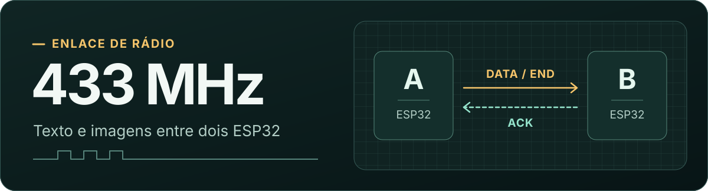

# Transmissão de texto e imagens com ESP32

Projeto final de **Transmissão e Comunicação de Dados** do curso de Engenharia da Computação do IFMT. Duas estações ESP32 trocam mensagens e pequenas imagens por rádio de **433 MHz**. O firmware usa **CRC-8** para detectar erros e **Stop-and-Wait ARQ** para retransmitir quadros que ficaram sem confirmação.

[Montagem e pinagem](#montagem-e-pinagem) · [Protocolo](#protocolo-de-comunicação) · [Como executar](#como-executar) · [Testes e resultados](#testes-e-resultados) · [Código-fonte](#onde-está-o-código)

## O projeto na bancada


*Estação A à esquerda e estação B à direita, com os ESP32 encaixados nas protoboards.*

Os computadores se conectam às estações por USB. Entre os ESP32, tanto os dados quanto as confirmações passam pelos módulos de rádio. Cada estação tem um transmissor e um receptor para permitir a troca de papéis, com um envio por vez. Na demonstração, A envia e B exibe o texto no OLED ou entrega os dados ao computador receptor.

## Montagem e pinagem

Cada estação usa um **ESP32 DevKit**, uma protoboard, um transmissor de 433 MHz (FS1000A como referência), um receptor de 433 MHz (MX-RM-5V como referência), dois resistores de **10 kΩ**, jumpers e um cabo USB de dados. Em B, um **OLED SSD1306 I²C de 128 × 64** mostra o texto recebido.

| Pino do componente | Ligação na bancada |
| --- | --- |
| DATA do transmissor | GPIO25 do ESP32 local. |
| VCC do transmissor | VIN na montagem documentada, com o ESP32 alimentado por USB. |
| DATA do receptor | R1 do divisor de tensão. A junção de R1 e R2 vai ao GPIO34. |
| VCC do receptor | 5 V no esquema de referência do MX-RM-5V. |
| GND dos módulos RF | GND do ESP32 da própria estação. |
| VCC e GND do OLED de B | 3V3 e GND do ESP32 B. |
| SDA e SCL do OLED de B | GPIO21 e GPIO22, respectivamente. |

Em cada receptor, R1 liga a saída DATA ao GPIO34 e R2 liga essa junção ao GND. Com dois resistores de 10 kΩ, uma saída de 5 V equivale a **2,5 V** na entrada analógica no cálculo ideal. Confira a posição dos pinos no seu módulo antes de conectar. [Guia completo de montagem](docs/montagem.md)

## Protocolo de comunicação

### Formato dos quadros

| Campo | Bytes | Função |
| --- | ---: | --- |
| `FLAG` | 1 | Marca o início do quadro com `0x7E`. |
| `TYPE` | 1 | Identifica `DATA` (`0x01`), `ACK` (`0x02`) ou `END` (`0x03`). |
| `SEQ` | 1 | Identifica a sequência do quadro. O ACK repete esse número. |
| `LEN` | 1 | Informa quantos bytes estão no campo `DATA`. |
| `DATA` | 0–16 | Carrega os metadados ou um trecho do conteúdo. O campo é vazio em ACK e END. |
| `FCS` | 1 | Guarda a verificação de `TYPE`, `SEQ`, `LEN` e `DATA`. |

O primeiro quadro DATA, com `seq=0`, anuncia o formato e o tamanho da mensagem. Os quadros seguintes levam até **15 bytes úteis** por vez, mais um byte que identifica o trecho como conteúdo. O quadro END encerra a transferência depois que todos os trechos são confirmados.

### Detecção de erros e retransmissão

O FCS pode usar **checksum** (soma dos bytes módulo 256) ou **CRC-8** (polinômio `0x07`). A calcula o FCS antes do envio. B refaz o cálculo com os bytes recebidos e descarta o quadro se os valores divergirem.

Com **Stop-and-Wait ARQ**, A envia um quadro por vez e espera cerca de **1,2 s** pelo ACK da mesma sequência. Quando a espera vence, A retransmite o quadro, até **seis tentativas no total**. Se B já aceitou o quadro, reenvia o ACK e só incorpora o conteúdo na primeira recepção válida. O END é confirmado quando o total recebido coincide com o anunciado no início. [Detalhes dos quadros, do CRC-8 e do Stop-and-Wait](docs/arquitetura.md)

## Como executar

### 1. Monte e grave as estações

1. Use o [guia de montagem](docs/montagem.md) para conferir os componentes, o divisor de tensão e a pinagem de A e B.
2. Instale o pacote **esp32 by Espressif Systems** e a biblioteca **U8g2** na Arduino IDE.
3. Abra [Estacao_A.ino](firmware/Estacao_A/Estacao_A.ino) e [Estacao_B.ino](firmware/Estacao_B/Estacao_B.ino) para gravar as respectivas placas. Use o perfil **ESP32 Dev Module** e mantenha os arquivos `.h` na pasta de cada sketch.

### 2. Envie texto ou o bitmap pelo Arduino IDE

Abra os dois Monitores Seriais em **115200 baud**, com final de linha **Nova linha**. Nos dois lados, envie `MODO CRC` e depois `STATUS` para conferir `FCS=CRC-8`. O firmware volta a checksum quando reinicia.

| Onde digitar | Comando | O que observar |
| --- | --- | --- |
| A | `TEXTO TESTE` | B imprime a mensagem no Monitor Serial e a mostra no OLED. |
| A | `ERRO TEXTO Olá mundo!` | B registra `FCS_INVALIDO`. A mostra o timeout e retransmite o quadro. B entrega o texto correto. |
| A | `IMAGEM` | B imprime o bitmap de 16 × 16 pixels e mostra `Imagem recebida` no OLED. |
| A | `ERRO IMAGEM` | A altera um bit do primeiro quadro de conteúdo do bitmap para testar a retransmissão. |
| A e B | `MODO CHECKSUM` | Seleciona o checksum de 8 bits para comparar com o teste em CRC-8. |

O limite de texto é de **256 bytes** por mensagem. Para registrar o teste de erro, compare o número de sequência nos logs de A e B do mesmo envio.

### 3. Transfira um arquivo de imagem pelo PowerShell

Use os sketches das estações A e B gravados no passo 1. Feche os Monitores Seriais para liberar as portas. Em cada computador, abra o PowerShell na pasta raiz do repositório e execute os comandos com Python 3.8 ou superior instalado.

```powershell
cd .\computadores
py -m pip install -r .\requirements.txt
```

No **computador B**, inicie a recepção e aguarde `Receptor pronto`.

```powershell
py .\imagem_rf.py receber COM4
```

No **computador A**, envie o [PNG de teste](computadores/teste.png).

```powershell
py .\imagem_rf.py enviar COM3 ".\teste.png"
```

Use a porta atribuída à sua placa no lugar de `COM3` ou `COM4`. O programa ativa CRC-8 ao abrir cada porta. Quando B mostrar `Imagem salva em`, abra o arquivo em `computadores/recebidos/`. Encerre a recepção com `Ctrl+C` para liberar a porta.

Para enviar outra imagem, passe o caminho de um PNG ou JPEG pequeno. O comando `IMAGEM` do Arduino também pode gerar um PNG em B quando o programa Python estiver em modo `receber` e A estiver em CRC-8.

### Como a imagem é remontada

No envio de um PNG ou JPEG, o Python divide o arquivo em blocos de até **165 bytes**, codifica cada bloco em Base64 e envia os blocos ao ESP32 em mensagens `@IMG433`. O firmware transporta cada mensagem pelo rádio usando os mesmos quadros e ACKs do texto. No PC B, o programa confere a ordem dos blocos, o tamanho, a assinatura do formato e o **SHA-256** do arquivo completo antes de salvar. [Fluxo do texto, do bitmap e dos arquivos](docs/arquitetura.md#4-texto-bitmap-e-arquivo-de-imagem)

## Testes e resultados

| Ensaio | Resultado observado | Evidência |
| --- | --- | --- |
| Texto e OLED | B exibiu a mensagem `TESTE` recebida de A. | [Foto do OLED](docs/evidencias.md#texto-no-oled) |
| Erro proposital | B descartou o quadro com CRC inválido. A retransmitiu, e B entregou o texto correto. | [Monitores Seriais de A e B](docs/evidencias.md#detecção-e-retransmissão) |
| Arquivo de imagem | O programa remontou o PNG de teste de 134 bytes e salvou o arquivo no computador B. | [Pasta do receptor](docs/evidencias.md#arquivo-de-imagem) |
| Alcance | A equipe concluiu um envio a **110 cm (1,10 m)** entre as estações. | [Foto da bancada com a trena](docs/evidencias.md#alcance) |
| Ensaio sob ruído | Pendente. | [Como registrar o ensaio](docs/testes.md#roteiro-de-demonstração) |

### Exemplo de detecção e recuperação

No teste com `ERRO TEXTO Olá mundo!`, A calculou `E7` para o quadro `seq=1` e alterou o primeiro byte do texto de `4F` para `4E`. B recalculou o CRC e obteve `F8`, por isso registrou `FCS_INVALIDO` e descartou o quadro sem enviar ACK. A atingiu o `TIMEOUT` e enviou os bytes originais na tentativa seguinte. B aceitou o quadro, confirmou a sequência 1 e exibiu o texto correto após o END.


### Leitura dos registros

| Registro | O que indica |
| --- | --- |
| `FCS_INVALIDO` repetido | O FCS calculado divergiu do recebido. Confira com `STATUS` se A e B usam o mesmo modo. |
| `TIMEOUT` ou `FALHA` | A não recebeu o ACK no prazo. Confira se B está ligado e teste a comunicação a curta distância. |
| `DUPLICADO` | B reconheceu um quadro já processado e reenviou o ACK. |
| `ENVIO CONCLUIDO` | O emissor recebeu o ACK do END de uma mensagem. |
| `Imagem salva em` | O computador B remontou e gravou o arquivo no caminho mostrado. |

Veja também como testar a ausência de ACK, liberar uma porta serial ocupada e comparar os arquivos pelo SHA-256. [Roteiro completo de testes](docs/testes.md)

## Onde está o código

| Caminho | Conteúdo |
| --- | --- |
| [`firmware/Estacao_A/`](firmware/Estacao_A/) | Sketch da estação A e módulos de rádio, protocolo e bitmap. |
| [`firmware/Estacao_B/`](firmware/Estacao_B/) | Sketch da estação B com os módulos compartilhados e o OLED habilitado. |
| [`computadores/`](computadores/) | Interface serial em Python, transferência e gravação da imagem no PC. |
| [`docs/`](docs/) | Montagem, formato dos quadros, leitura do código, testes e evidências. |

| Função | Responsabilidade |
| --- | --- |
| [`calcularFCS()`](firmware/Estacao_A/Radio.h#L32-L43) | Calcula o checksum ou o CRC-8 dos bytes protegidos. |
| [`enviarQuadro()`](firmware/Estacao_A/Aplicacao.h#L90-L119) | Envia o quadro, aguarda o ACK e controla as tentativas. |
| [`processar()`](firmware/Estacao_A/Aplicacao.h#L33-L88) | Trata início, conteúdo e fim de uma transferência recebida. |
| [`Receptor.receber_arquivo()`](computadores/imagem_rf.py#L100-L134) | Remonta e valida o PNG ou JPEG recebido pelo computador. |

[Guia das funções do firmware em C++ e do programa em Python](docs/arquitetura.md#onde-ler-o-código)

## Equipe

Emily Weber de Arruda · Giovani Eduardo de Sousa Filho · Pedro da Silva Correa

Engenharia da Computação, IFMT – Campus Cuiabá Cel. Octayde Jorge da Silva. Disciplina de Transmissão e Comunicação de Dados, professor Ruy Oliveira, 2026.
