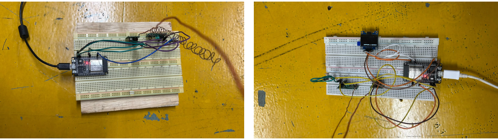

# Transmissão de texto e imagens com ESP32

Projeto final de **Transmissão e Comunicação de Dados** do curso de Engenharia da Computação do IFMT. Duas estações ESP32 trocam mensagens e pequenas imagens por rádio de **433 MHz**. O firmware usa **CRC-8** para detectar erros e **Stop-and-Wait ARQ** para retransmitir quadros que ficaram sem confirmação.

[Como executar](#como-executar) · [Montagem](docs/montagem.md) · [Código e protocolo](docs/arquitetura.md) · [Evidências de bancada](docs/evidencias.md) · [Roteiro de testes](docs/testes.md)

## O projeto na bancada



*Estação A à esquerda e estação B à direita, com os ESP32 encaixados nas protoboards.*

Os computadores se conectam às estações por USB. Entre os ESP32, tanto os dados quanto as confirmações passam pelos módulos de rádio. Cada estação tem um transmissor e um receptor para permitir a troca de papéis, com um envio por vez. Na demonstração, A envia e B exibe o texto no OLED ou entrega os dados ao computador receptor.

| Ensaio | Resultado observado | Evidência |
| --- | --- | --- |
| Texto e OLED | B exibiu a mensagem `TESTE` recebida de A. | [Foto do OLED](docs/evidencias.md#texto-no-oled) |
| Erro proposital | B descartou o quadro com CRC inválido. A retransmitiu, e B entregou o texto correto. | [Monitores seriais de A e B](docs/evidencias.md#detecção-e-retransmissão) |
| Arquivo de imagem | O programa remontou o PNG de teste de 134 bytes e salvou o arquivo no computador B. | [Pasta do receptor](docs/evidencias.md#arquivo-de-imagem) |
| Alcance | A equipe concluiu um envio a **110 cm (1,10 m)** entre as estações. | [Foto da bancada com a trena](docs/evidencias.md#alcance) |
| Ensaio sob ruído | Pendente. | [Como registrar o ensaio](docs/testes.md#roteiro-de-demonstração) |

## Como executar

### 1. Monte e grave as estações

1. Use o [guia de montagem](docs/montagem.md) para conferir os componentes, o divisor de tensão e a pinagem de A e B.
2. Instale o pacote **esp32 by Espressif Systems** e a biblioteca **U8g2** na Arduino IDE.
3. Abra [Estacao_A.ino](firmware/Estacao_A/Estacao_A.ino) e [Estacao_B.ino](firmware/Estacao_B/Estacao_B.ino) para gravar as respectivas placas. Use o perfil **ESP32 Dev Module** e mantenha os arquivos `.h` na pasta de cada sketch.

### 2. Envie texto ou o bitmap pelo Arduino IDE

Abra os dois Monitores Seriais em **115200 baud**, com final de linha **Nova linha**. Nos dois lados, envie `MODO CRC` e depois `STATUS` para conferir `FCS=CRC-8`. O firmware volta a checksum quando reinicia.

| Onde digitar | Comando | O que observar |
| --- | --- | --- |
| A | `TEXTO TESTE` | B imprime a mensagem no Monitor Serial e a mostra no OLED. |
| A | `ERRO TEXTO Olá mundo!` | B registra `FCS_INVALIDO`. A mostra o timeout e retransmite o quadro. B entrega o texto correto. |
| A | `IMAGEM` | B imprime o bitmap de 16 × 16 pixels e mostra `Imagem recebida` no OLED. |
| A | `ERRO IMAGEM` | A altera um bit do primeiro quadro de conteúdo do bitmap para testar a retransmissão. |
| A e B | `MODO CHECKSUM` | Seleciona o checksum de 8 bits para comparar com o teste em CRC-8. |

O limite de texto é de **256 bytes** por mensagem. Para registrar o teste de erro, compare o número de sequência nos logs de A e B do mesmo envio.

### 3. Transfira um arquivo de imagem pelo PowerShell

Use o mesmo firmware nas duas placas. Feche os Monitores Seriais para liberar as portas. Em cada computador, abra o PowerShell na pasta raiz do repositório e execute os comandos com Python 3.8 ou superior instalado.

```powershell
cd .\computadores
py -m pip install -r .\requirements.txt
```

No **computador B**, inicie a recepção e aguarde `Receptor pronto`.

```powershell
py .\imagem_rf.py receber COM4
```

No **computador A**, envie o [PNG de teste](computadores/teste.png).

```powershell
py .\imagem_rf.py enviar COM3 ".\teste.png"
```

Use a porta atribuída à sua placa no lugar de `COM3` ou `COM4`. O programa ativa CRC-8 ao abrir cada porta. Quando B mostrar `Imagem salva em`, abra o arquivo em `computadores/recebidos/`. Encerre a recepção com `Ctrl+C` para liberar a porta.

Para enviar outra imagem, passe o caminho de um PNG ou JPEG pequeno. O comando `IMAGEM` do Arduino também pode gerar um PNG em B quando o programa Python estiver em modo `receber` e A estiver em CRC-8.

## Onde está o código

| Caminho | Conteúdo |
| --- | --- |
| [`firmware/Estacao_A/`](firmware/Estacao_A/) | Sketch da estação A e módulos de rádio, protocolo e bitmap. |
| [`firmware/Estacao_B/`](firmware/Estacao_B/) | Sketch da estação B com os módulos compartilhados e o OLED habilitado. |
| [`computadores/`](computadores/) | Interface serial em Python, transferência e gravação da imagem no PC. |
| [`docs/`](docs/) | Montagem, formato dos quadros, leitura do código, testes e evidências. |

O [guia do código](docs/arquitetura.md#onde-ler-o-código) liga cada etapa do protocolo às funções que a implementam. Ele inclui os bytes do teste de CRC e a diferença entre a confirmação de um quadro pelo ESP32 e a gravação do arquivo pelo computador receptor.

## Equipe

Emily Weber de Arruda · Giovani Eduardo de Sousa Filho · Pedro da Silva Correa

Engenharia da Computação, IFMT – Campus Cuiabá Cel. Octayde Jorge da Silva. Disciplina de Transmissão e Comunicação de Dados, professor Ruy Oliveira, 2026.
