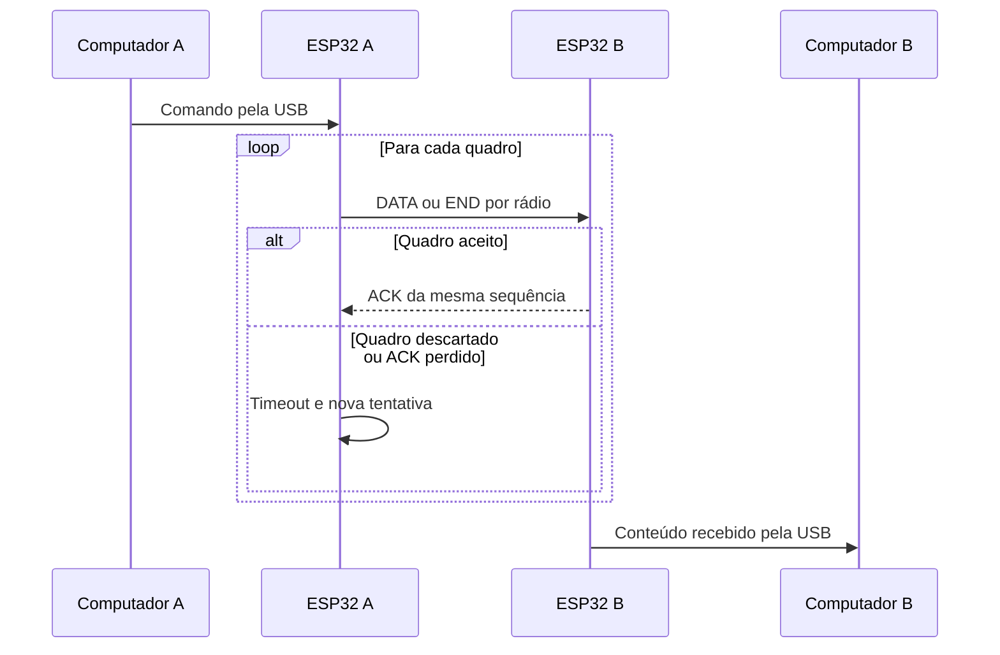

# Arquitetura e explicação do código

[Voltar ao README](../README.md)

O sistema tem três responsabilidades. O computador comanda a operação pela USB local. O firmware fragmenta, protege e confirma os dados. O rádio de 433 MHz transporta os quadros entre as estações. O OLED fica ligado somente a B.

## Onde ler o código

| Arquivo | Responsabilidade | Pontos de entrada |
| --- | --- | --- |
| [Estacao_A.ino](../firmware/Estacao_A/Estacao_A.ino) e [Estacao_B.ino](../firmware/Estacao_B/Estacao_B.ino) | Iniciam a serial e o rádio. B também inicia o display. | `setup()` e `loop()` |
| [Radio.h](../firmware/Estacao_A/Radio.h) | Define o quadro, implementa o FCS e converte os bytes em pulsos Manchester e vice-versa. | `calcularFCS()`, `transmitir()`, `receber()` |
| [Aplicacao.h](../firmware/Estacao_A/Aplicacao.h) | Interpreta comandos, fragmenta o conteúdo, faz Stop-and-Wait e remonta a recepção. | `comandoSerial()`, `enviarArquivo()`, `enviarQuadro()`, `processar()` |
| [Tela.h](../firmware/Estacao_B/Tela.h) | Inicializa o I²C e exibe texto com U8g2 na configuração usada em B. | `iniciarTela()` e `exibir()` |
| [Imagem.h](../firmware/Estacao_A/Imagem.h) | Armazena 32 bytes do bitmap monocromático de 16 × 16 pixels. | `IMAGEM` |
| [imagem_rf.py](../computadores/imagem_rf.py) | Usa a serial para transferir PNG/JPEG ou para salvar o bitmap como PNG. | `CanalUSB`, `mensagens_de_imagem()` e `Receptor` |

Os arquivos `.h` comuns estão nas duas pastas para que cada sketch possa ser aberto e gravado separadamente pela Arduino IDE. Em cada loop, a estação procura um quadro e verifica se há um comando vindo do computador. A direção do envio é definida por quem digita o comando.

## 1. Quadros e codificação Manchester

O preâmbulo dura 48 ciclos de 1 ms em nível alto e 1 ms em nível baixo. Depois vêm 6 ms em alto e 2 ms em baixo para sincronismo. Cada bit ocupa duas metades de 1 ms. Um 0 vai de alto para baixo e um 1 vai de baixo para alto. Assim, a taxa nominal durante os bits do quadro é de **500 bit/s**. O preâmbulo, as confirmações e as retransmissões reduzem a taxa útil.

Em `lerNivel()`, o ADC lê a tensão no GPIO34. Durante a busca do sincronismo, a leitura parte de 1050 mV e pode ajustar o limiar entre o mínimo e o máximo de uma janela de 30 ms quando a diferença supera 150 mV. O firmware usa uma margem de 35 mV para decidir as transições. `receber()` reúne as metades, reconstrói os bytes e usa LEN para localizar o FCS.

| Campo | Bytes | Conteúdo |
| --- | ---: | --- |
| FLAG | 1 | `0x7E`, início do quadro. |
| TYPE | 1 | `0x01` para DATA, `0x02` para ACK e `0x03` para END. |
| SEQ | 1 | Número de sequência do quadro. O ACK usa a sequência que confirma. |
| LEN | 1 | Quantidade de bytes do campo DATA, de 0 a 16. |
| DATA | 0–16 | Metadados ou trecho do conteúdo. ACK e END têm LEN igual a zero. |
| FCS | 1 | Resultado de checksum ou CRC-8 calculado sobre TYPE, SEQ, LEN e DATA. |

O primeiro DATA tem sequência 0 e oito bytes de metadados. Ele traz o marcador `1`, o formato `T` para texto ou `I` para bitmap, quatro bytes de identificação e dois bytes do tamanho anunciado em ordem do mais significativo para o menos significativo. Os DATA do conteúdo começam em sequência 1 e trazem um marcador `2` seguido de até 15 bytes úteis. O END tem a sequência seguinte. FLAG e o próprio FCS ficam fora da região protegida.

## 2. Checagem por checksum e CRC-8

O checksum soma os bytes protegidos e guarda o resultado módulo 256. O CRC-8 inicia o acumulador em `0x00`. Para cada byte, calcula o XOR com o acumulador. Em seguida, desloca o acumulador oito vezes para a esquerda e aplica XOR com `0x07` a cada passo cujo bit mais significativo anterior ao deslocamento era 1. O acumulador se mantém em oito bits. A configuração usa o polinômio x⁸ + x² + x + 1, sem reflexão e com XOR final de `0x00`.

A função `transmitir()` acrescenta o FCS antes de codificar os bits. `receber()` recalcula localmente o valor e só entrega o quadro a `processar()` quando os resultados coincidem. Se a checagem falhar, imprime `FCS_INVALIDO` e descarta o quadro.

No ensaio com **Olá mundo!**, o primeiro quadro de conteúdo tem 12 bytes no campo DATA. São 11 bytes UTF-8 de texto mais o marcador `02`. O comando `ERRO TEXTO` altera o bit menos significativo do primeiro byte do conteúdo, de `4F` para `4E`, após gravar o FCS.

| Caso | Bytes protegidos em hexadecimal | CRC-8 |
| --- | --- | --- |
| Quadro correto | `01 01 0C 02 4F 6C C3 A1 20 6D 75 6E 64 6F 21` | `E7` |
| Quadro após a corrupção | `01 01 0C 02 4E 6C C3 A1 20 6D 75 6E 64 6F 21` | `F8` |

O receptor recebe o FCS `E7` e calcula `F8` a partir dos bytes alterados. Como os valores divergem, descarta a primeira tentativa. Na retransmissão, o emissor envia os bytes originais.

## 3. Stop-and-Wait ARQ

`enviarArquivo()` envia o início, os quadros de conteúdo e o END. Para cada um, `enviarQuadro()` transmite e aguarda aproximadamente 1,2 s por um ACK válido da mesma sequência. O timeout dispara outra tentativa do quadro. A falha após seis tentativas interrompe a transferência e é informada pela serial.

Em B, `processar()` verifica a sequência esperada e acrescenta ao buffer apenas o conteúdo aceito. O firmware guarda o último quadro aceito. Se ele chegar novamente, B reenvia o ACK sem incorporar os mesmos bytes duas vezes. B confirma o END quando o total recebido coincide com o tamanho anunciado e então exibe a mensagem. O emissor informa `ENVIO CONCLUIDO` ao receber a confirmação do END.

## 4. Texto, bitmap e arquivo de imagem

**Texto.** A sequência `TEXTO mensagem` usa formato `T` e aceita até 256 bytes. Depois do END, B imprime o texto no Monitor Serial e chama `exibir()`. O OLED renderiza até seis linhas com 21 posições na fonte escolhida.

**Bitmap.** O comando `IMAGEM` usa formato `I` para enviar os 32 bytes de [Imagem.h](../firmware/Estacao_A/Imagem.h). `desenhar()` transforma cada bit em um pixel e imprime 16 linhas no Monitor Serial. Com o script aberto em B, `receber_bitmap()` coleta as linhas completas e `png_do_bitmap()` gera o arquivo PNG em escala de cinza.

**PNG ou JPEG.** A função `mensagens_de_imagem()` cria mensagens ASCII com o prefixo `@IMG433`. O início informa o identificador, o tamanho, o formato e o SHA-256. As mensagens de dados levam até 165 bytes do arquivo codificados em Base64, com o deslocamento de cada bloco. A mensagem final informa o encerramento. `CanalUSB` entrega essas mensagens ao ESP32 por meio de `TEXTO` e aguarda a conclusão de cada envio. O firmware usa a mesma fragmentação em DATA e a mesma confirmação por ACK que usa para texto comum.

Na recepção, `Receptor.processar()` identifica as linhas `Texto recebido: @IMG433` e passa o conteúdo para `receber_arquivo()`. Essa função verifica a ordem dos blocos e a integridade do arquivo completo. Se o tamanho, o formato e o SHA-256 conferirem, `salvar()` grava um arquivo temporário e o renomeia para o destino final em `computadores/recebidos/`. O CRC-8 verifica quadros individuais e o SHA-256 permite comparar o resultado remontado com o arquivo de origem.

## 5. Leitura dos diagnósticos

| Registro | Significado |
| --- | --- |
| `TX tipo=… seq=… len=… tentativa=…` | Quadro que está saindo, sua sequência, comprimento de DATA e tentativa atual. |
| `FCS_INVALIDO` | Divergência entre o FCS recebido e o calculado. O log informa ambos os valores. |
| `TIMEOUT` | A espera pelo ACK correspondente terminou. A origem pode retransmitir o quadro. |
| `DUPLICADO` | B reconheceu um quadro já aceito e reenviou o ACK. |
| `ENVIO CONCLUIDO` | A recebeu o ACK do END. |
| `Imagem salva em` | O programa receptor gravou o arquivo e indicou seu caminho. |

`STATUS` informa o FCS e o estado de recepção. `DIAG` registra a faixa de tensão, o limiar e a contagem de bordas no ADC local. `SINAL` emite pulsos de diagnóstico durante cerca de 10 s para que a outra estação faça uma leitura com `DIAG`. Os valores do ADC descrevem a saída do receptor após o divisor.
