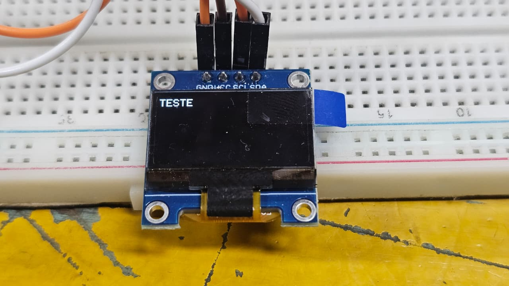
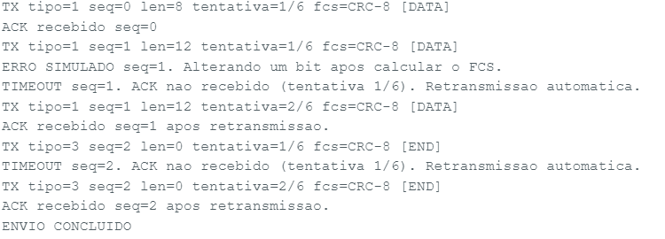
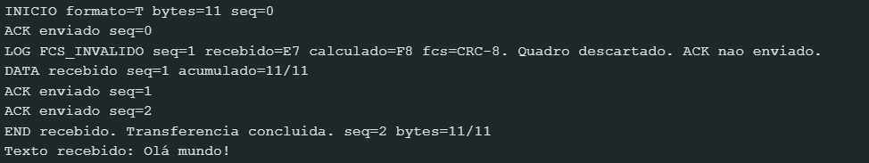
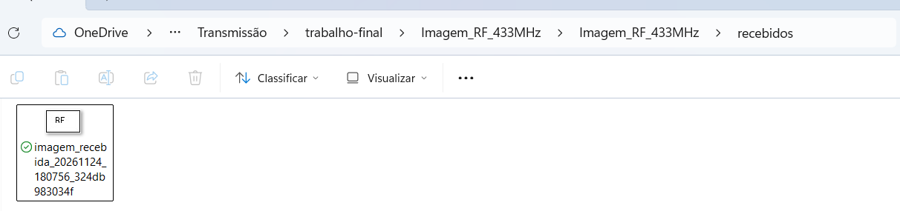
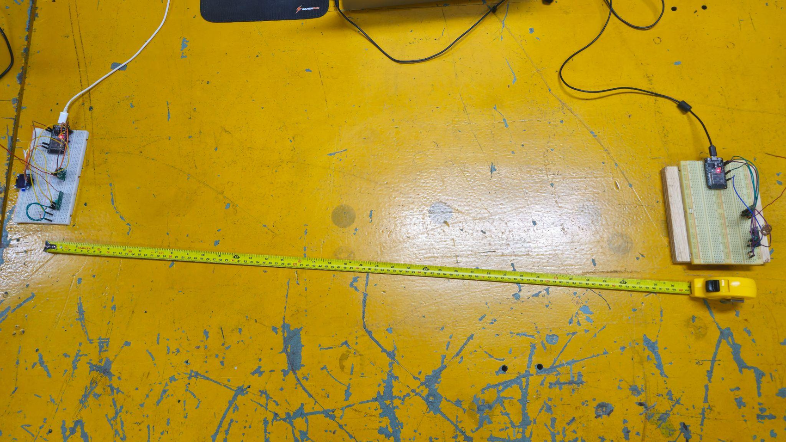

# Evidências de bancada

[Voltar ao README](../README.md) · [Repetir os testes](testes.md)

## Texto no OLED

Ao enviar `TEXTO TESTE` da estação A, a estação B remontou o texto recebido pelo rádio e o exibiu no OLED. A mesma mensagem pode ser conferida no Monitor Serial de B.

## Detecção e retransmissão

Nos Monitores Seriais, configure `MODO CRC` em A e B. Em A, envie `ERRO TEXTO Olá mundo!`. O firmware inverte um bit após calcular o FCS do primeiro quadro de conteúdo. Depois do descarte em B e do timeout em A, a próxima tentativa leva os bytes originais.

| Etapa | Estação | Registro a conferir |
| --- | --- | --- |
| Corrupção deliberada | A | `ERRO SIMULADO seq=1` na tentativa 1 de 6. |
| Detecção | B | `FCS_INVALIDO seq=1`, com FCS recebido `E7` e calculado `F8`. O quadro foi descartado sem ACK. |
| Recuperação | A e B | A registra `TIMEOUT seq=1`, tenta de novo e recebe o ACK. B aceita a sequência 1 e entrega `Olá mundo!` ao finalizar. |

**Monitor Serial de A.** A sequência 1 foi confirmada após a retransmissão. Nesse registro também houve uma nova tentativa para o END, na sequência 2.

**Monitor Serial de B.** Após detectar o CRC inválido, o receptor aceitou a sequência 1 retransmitida e imprimiu o texto correto.

O [cálculo do CRC-8](arquitetura.md#2-checagem-por-checksum-e-crc-8) mostra quais bytes produziram os valores `E7` e `F8`.

## Arquivo de imagem

A equipe enviou o arquivo [`teste.png`](../computadores/teste.png), de 134 bytes, pelo PowerShell. A captura mostra o PNG que o programa salvou na pasta `recebidos` do computador B. O script valida o tamanho, a assinatura do formato e o SHA-256 dos dados remontados antes de gravar o arquivo.

Para repetir, abra o receptor antes de iniciar o envio e aguarde `Imagem salva em` no computador B. Use os [comandos do PowerShell](../README.md#3-transfira-um-arquivo-de-imagem-pelo-powershell).

## Alcance

A equipe mediu **110 cm (1,10 m)** entre as estações com uma trena e concluiu um envio nessa posição. A foto registra a montagem e a posição das estações durante a medição.

O ensaio sob ruído está pendente. O [roteiro de testes](testes.md#roteiro-de-demonstração) indica o que medir quando esse ensaio for realizado.
